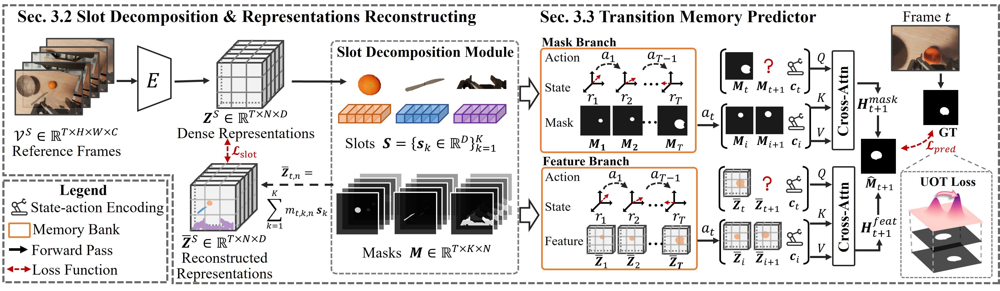
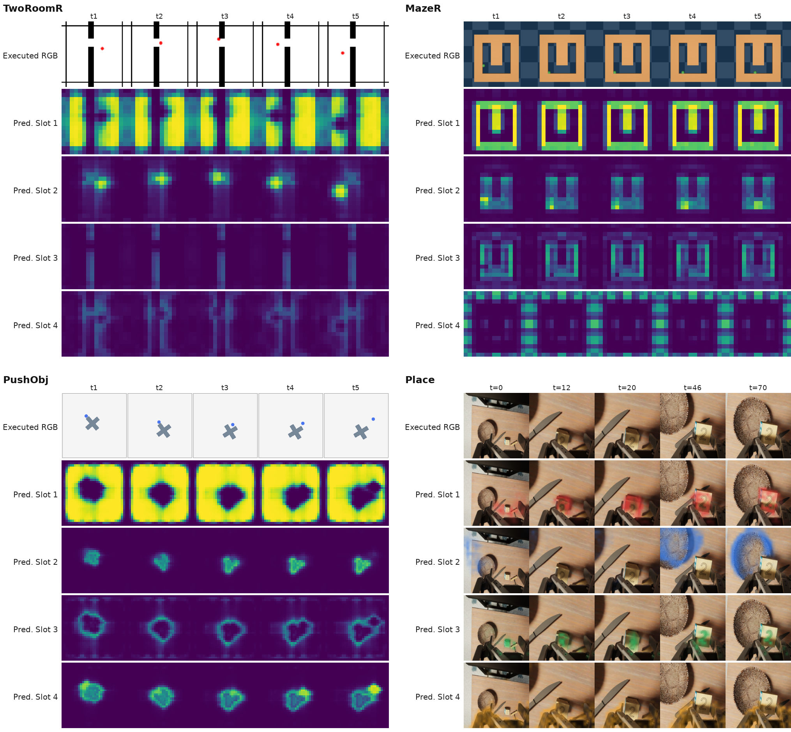
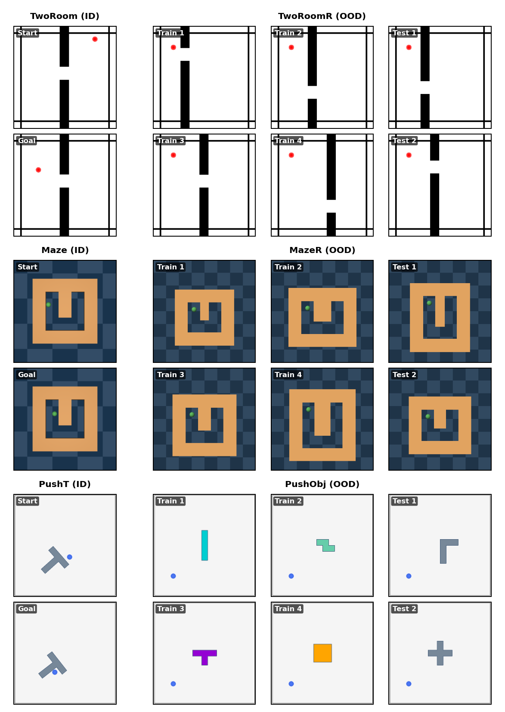
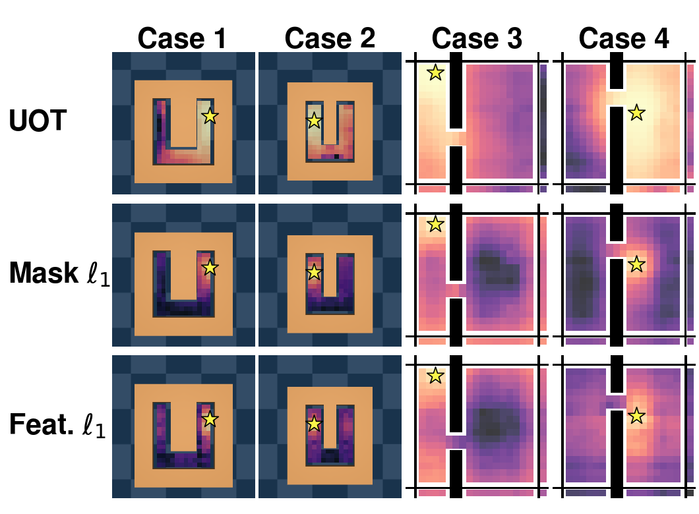
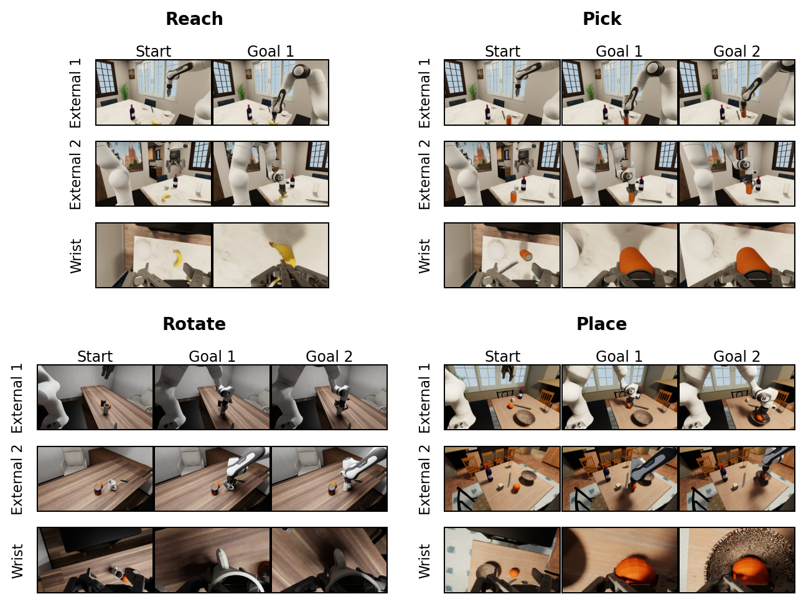

# Slot-JEPA

This is the official implementation of **Slot-JEPA: Object-Structured Prediction Interfaces for Latent World Models** ([arXiv:2610.28074](https://arxiv.org/abs/2610.28074)).

[](https://arxiv.org/abs/2610.28074) [](https://www.python.org/) [](https://pytorch.org/)

**Slot-JEPA: Object-Structured Prediction Interfaces for Latent World Models**



Slot-based Joint-Embedding Predictive Architecture (**Slot-JEPA**) converts dense patch representations into a reusable object-structured interface. It factorizes the visual feature field into stable semantic slots and time-varying spatial masks while preserving the original representation through reconstruction.
The **Transition Memory Predictor (TMP)** stores observed transitions as compact masks and retrieves relevant, potentially non-contiguous context. An **Unbalanced Optimal Transport (UOT)** objective supervises future-mask prediction and supplies a spatially informative visual-goal distance for planning.

## 🚩 Highlights

- **Reusable object structure:** the slot decomposition is pretrained once and frozen for downstream tasks.
- **Transition memory:** TMP retrieves useful history instead of relying only on a short contiguous context window.
- **Transport-based planning:** UOT remains informative when predicted and goal masks have little spatial overlap.
- **Broad evaluation:** seven visual-understanding benchmarks, six planar environments, and 108 REALM-JEPA robotic-arm cases.
- **Minimal release:** the repository contains the final functional code, while checkpoints, planar datasets, compact robot visual goals, and loading configs are distributed as separate artifact archives; caches and run outputs are generated locally.

## 📊 Main Results

The following values are taken from the current paper. Evaluation outputs are not packaged and should be reproduced with the released workflows.

### Visual Understanding


| Method        | COCO mIoU | ADE mIoU | VOC mIoU | NYUv2 δ1 | KITTI δ1 | SUNRGBD δ1 | DAVIS J&F |
| --------------- | ----------: | ---------: | ---------: | ----------: | ----------: | ------------: | ----------: |
| V-JEPA 2.1    |      52.8 |     35.5 |     72.1 |      80.5 |  **89.2** |        70.0 |      65.9 |
| **Slot-JEPA** |  **56.1** | **38.9** | **75.1** |  **83.1** |      87.8 |    **72.3** |  **66.6** |

### Planar Visual Planning

Success rates (%) use visual goals without low-dimensional goal-state input.


| Method        | TwoRoom |    Maze |  PushT | TwoRoomR |   MazeR | PushObj |
| --------------- | --------: | --------: | -------: | ---------: | --------: | --------: |
| DINO-WM       |      50 | **100** |     74 |       82 |      86 |      28 |
| V-JEPA 2.1    |      50 |      94 |     58 |       50 |      86 |      46 |
| LeWM          |      80 |      98 |     88 |       52 |      88 |      30 |
| **Slot-JEPA** | **100** | **100** | **94** |   **90** | **100** |  **66** |

### Robotic Arm Planning


| Method           |              Reach |              Pick |            Rotate |             Place |            Overall |
| ------------------ | -------------------: | ------------------: | ------------------: | ------------------: | -------------------: |
| V-JEPA 2.1       |      13/18 (72.2%) |     19/30 (63.3%) |      6/30 (20.0%) |       0/30 (0.0%) |     38/108 (35.2%) |
| V-JEPA 2.1 + TMP |      16/18 (88.9%) |     22/30 (73.3%) |     13/30 (43.3%) |     12/30 (40.0%) |     63/108 (58.3%) |
| **Slot-JEPA**    | **18/18 (100.0%)** | **27/30 (90.0%)** | **25/30 (83.3%)** | **23/30 (76.7%)** | **93/108 (86.1%)** |

<p align="center"></p>
<p align="center"><em>Predicted masks along successful TwoRoomR, MazeR, PushObj, and Place rollouts.</em></p>

## 🗂️ Repository Structure

```text
slot_jepa_release/
├── assets/                        # figures used by this README
├── requirement.txt                # verified Python environment
├── src/slot_jepa/                 # shared Slot-JEPA implementation
│   ├── encoders/                  # visual encoders
│   ├── slots/                     # slot decomposition and mask decoding
│   ├── predictors/                # TMP and action-conditioned prediction
│   ├── losses/                    # reconstruction, mask, and UOT losses
│   ├── data/                      # shared pretraining datasets
│   └── utils/                     # distributed and logging utilities
├── workflows/
│   ├── pretrain/                  # Kinetics-400 Slot-JEPA pretraining
│   ├── representation_eval/       # segmentation, depth, and VOS
│   ├── planar/                    # planar world-model training and planning
│   └── robot/                     # DROID training and REALM-JEPA planning
├── artifacts/                     # checkpoints, configs, planar data, and robot goals
├── manifests/                     # artifact selection and provenance
├── scripts/                       # release validation
└── tests/                         # structural tests
```

All workflows import the shared implementation from `src/slot_jepa`. After downloading the artifact archives below, the curated planar datasets are restored under `artifacts/data/planar/`, and the minimal REALM-JEPA visual goals are restored under `artifacts/data/robot/successful_case/`; generated outputs stay outside `artifacts/`.

## 💻 Environment

- Python 3.9.15
- PyTorch 2.2.2+cu118
- TorchVision 0.17.2+cu118
- XFormers 0.0.25.post1+cu118
- CUDA 11.8
- MuJoCo for planar navigation and manipulation
- REALM/OmniGibson for robotic-arm planning

The workflows use different vision and simulator toolchains, so install only the dependencies needed for the task being reproduced.

## 🔧 Installation

Install the verified release environment and shared package from the release root:

```bash
pip install -r requirement.txt
pip install -e .
```

The root dependency file is the canonical environment for this release. Workflow-local dependency files are retained only as upstream provenance and should not be installed on top of `requirement.txt`.

MuJoCo and REALM/OmniGibson setup is documented in the corresponding workflow guides below.

## 🚀 Slot-JEPA Pretraining

The final configuration starts from a V-JEPA 2.1 ViT-B/16 encoder and jointly pretrains the slot decomposition and TMP on Kinetics-400 at `384 x 384`. It uses 16 global slots and fine-tunes the final six encoder blocks.

```bash
torchrun --standalone --nproc_per_node=8 \
  workflows/pretrain/train.py \
  --fname workflows/pretrain/configs/k400.yaml
```

Kinetics-400 is not bundled. Update its location in [`workflows/pretrain/configs/k400.yaml`](workflows/pretrain/configs/k400.yaml). See the [pretraining guide](workflows/pretrain/README.md) for model details, resume behavior, outputs, and TensorBoard.

## 📈 Visual-Understanding Evaluation

The frozen encoder and slot decomposition are evaluated on COCOStuff-27, ADE20K, PASCAL VOC, NYUv2, KITTI, NYUv2-to-SUNRGBD transfer, and DAVIS-2017.

```bash
cd workflows/representation_eval

python scripts/test_linear_seg.py \
  --config configs/tasks/linear_seg/coco_slot_jepa.yaml \
  --paths_config configs/paths.yaml

python scripts/test_depth.py \
  --config configs/tasks/depth/nyuv2_slot_jepa.yaml \
  --paths_config configs/paths.yaml

python scripts/test_vos.py \
  --config configs/tasks/vos/davis_slot_jepa.yaml \
  --paths_config configs/paths.yaml
```

Configure datasets in [`workflows/representation_eval/configs/paths.yaml`](workflows/representation_eval/configs/paths.yaml). See the [visual-understanding guide](workflows/representation_eval/README.md) for all seven protocols.

## 🧭 Planar Visual Planning

The benchmark contains three ID/OOD pairs: `TwoRoom / TwoRoomR`, `Maze / MazeR`, and `PushT / PushObj`.

<p align="center"></p>

```bash
cd workflows/planar

python scripts/train.py --config-name train_TwoRoom
python scripts/plan.py --config-name plan_TwoRoom
```

<p align="center"></p>
<p align="center"><em>Goal-loss landscapes in MazeR and TwoRoomR.</em></p>

See the [planar workflow guide](workflows/planar/README.md) for all six configurations and data preparation details.

## 🤖 Robotic Arm Planning

REALM-JEPA contains 108 cases across Reach, Pick, Rotate, and Place. Slot-JEPA is fine-tuned on DROID trajectories and plans from two external cameras and one wrist camera.

<p align="center"></p>

```bash
cd workflows/robot

python serve_slot.py \
  --ckpt-path ../../artifacts/checkpoints/downstream/robot/slot_jepa_droid_finetuned.pt \
  --config-path ../../artifacts/checkpoints/downstream/robot/slot_jepa_droid_finetuned.yaml
```

See the [REALM-JEPA workflow guide](workflows/robot/README.md) for DROID fine-tuning, simulator setup, the three-process planning architecture, and all four task families.

## 📦 Artifacts

Large artifacts are distributed separately and are intentionally ignored by Git. Download the five archives and restore their contents to the paths shown below, preserving the archive directory structure relative to the release root.

| Archive | Contents restored under | Download |
| --- | --- | --- |
| `color_channel_weights.zip` | `artifacts/color_channel_weights/` | [Google Drive](https://drive.google.com/file/d/1P2y0f5UCRhyy8Ij-rkpqb_83lTA6ABRa/view?usp=sharing) |
| `planar.zip` | `artifacts/checkpoints/downstream/planar/` and `artifacts/data/planar/` | [Google Drive](https://drive.google.com/file/d/1jKpAe5jOdFea_JEzfDRvEEamJhWfd6vm/view?usp=sharing) |
| `pretrain.zip` | `artifacts/checkpoints/pretrain/` | [Google Drive](https://drive.google.com/file/d/1ICmt3lTu0EfuCk7K1Ymt77B-dMWRkJet/view?usp=sharing) |
| `robot.zip` | `artifacts/checkpoints/downstream/robot/` and `artifacts/data/robot/` | [Google Drive](https://drive.google.com/file/d/1nSatahGz_L6E_mHlGrk7QsG0nDHUsHh6/view?usp=sharing) |
| `visual_understanding.zip` | `artifacts/checkpoints/downstream/visual_understanding/` | [Google Drive](https://drive.google.com/file/d/1xgxowQjRBFQpiOJyzmlRzZ-rLJEc72Ki/view?usp=sharing) |

After downloading the required archives, the artifact tree should look like this. Entries marked `[Git]` remain in the repository; entries marked `[download]` come from the archives and are ignored by Git.

```text
artifacts/
├── checkpoints/
│   ├── README.md                                      [Git]
│   ├── pretrain/
│   │   ├── SHA256SUMS                                [Git]
│   │   ├── slot_jepa_pretrained.pt                   [download: pretrain.zip]
│   │   └── slot_jepa_pretrained.yaml                 [download: pretrain.zip]
│   └── downstream/
│       ├── README.md                                  [Git]
│       ├── SHA256SUMS                                [Git]
│       ├── planar/outputs/<Task>/
│       │   ├── hydra.yaml                            [download: planar.zip]
│       │   └── checkpoints/model_latest.pth          [download: planar.zip]
│       ├── robot/
│       │   ├── README.md                             [Git]
│       │   ├── slot_jepa_droid_finetuned.pt          [download: robot.zip]
│       │   └── slot_jepa_droid_finetuned.yaml        [download: robot.zip]
│       └── visual_understanding/
│           ├── nyuv2_depth_head.pt                   [download: visual_understanding.zip]
│           ├── kitti_depth_head.pt                   [download: visual_understanding.zip]
│           └── sunrgbd_transfer_nyuv2_depth_head.pt  [download: visual_understanding.zip]
├── color_channel_weights/
│   ├── README.md                                      [Git]
│   └── planar_block12_important_objects_v2.*          [download: color_channel_weights.zip]
└── data/
    ├── planar/
    │   ├── README.md                                  [Git]
    │   ├── SHA256SUMS                                [Git]
    │   └── {TwoRoom,Maze,PushT,TwoRoomR,MazeR,PushObj}/
    │       └── ...                                    [download: planar.zip]
    └── robot/
        ├── README.md                                  [Git]
        └── successful_case/<case>/
            ├── manifest.json                         [download: robot.zip]
            ├── goal_targets.pt                       [download: robot.zip]
            └── {sg1,sg2,end}_{base,second,wrist}.png [download: robot.zip]
```

Download only the packages required for the workflow you intend to run:

| Downstream workflow | Required archives | Notes |
| --- | --- | --- |
| Semantic segmentation: COCOStuff-27, ADE20K, VOC | `robot.zip` | Uses the shared DROID-fine-tuned Slot-JEPA encoder; the linear probe is trained during evaluation. |
| Monocular depth: NYUv2, KITTI, SUNRGBD transfer | `robot.zip`, `visual_understanding.zip` | The robot archive provides the frozen encoder; the visual-understanding archive provides the released depth heads. If retraining a depth head, only `robot.zip` is required. |
| Video object segmentation: DAVIS-2017 | `robot.zip` | Label propagation is non-parametric, so no task-specific head is required. |
| Planar training or planning: TwoRoom, Maze, PushT, TwoRoomR, MazeR, PushObj | `pretrain.zip`, `planar.zip`, `color_channel_weights.zip` | Provides the frozen Slot-JEPA model, task datasets/targets, released predictors, and channel weights. |
| DROID fine-tuning | `pretrain.zip` | Also requires the external DROID dataset. Download `robot.zip` only when using or evaluating the released fine-tuned checkpoint. |
| REALM-JEPA robot planning | `robot.zip` | Provides both the fine-tuned model and all 108 visual-goal target packages. REALM/OmniGibson assets are installed separately. |

Dataset downloads for visual-understanding evaluation, Kinetics-400 pretraining data, the DROID training set, and REALM/OmniGibson simulator assets are not included in these five archives.

The repository retains the artifact `README.md` files and available `SHA256SUMS` manifests. After extraction, verify packages from the directory containing the corresponding checksum file, for example:

```bash
cd artifacts/checkpoints/pretrain
sha256sum -c SHA256SUMS

cd ../downstream
sha256sum -c SHA256SUMS

cd ../../data/planar
sha256sum -c SHA256SUMS
```

The downloaded payload provides the shared `pretrain/slot_jepa_pretrained.pt`, current downstream evaluation weights (including all six compact planar predictors), the frozen color-channel weights shared by the planar tasks, the six planar datasets, the minimal robot visual-goal package, and the configs needed to load them. Caches, TensorBoard logs, full robot rollouts, planning metrics, videos, and per-case inference outputs are not bundled. See [`ARTIFACTS.md`](manifests/ARTIFACTS.md) for the inventory.

Evaluation results are intentionally excluded. Running the representation, planar, or robot evaluation creates fresh local output directories that are ignored by Git.

## ✅ Validation

```bash
python scripts/validate_release.py
python -m unittest tests.test_layout
```

## 🖋️ Citation

If you find this work useful, please cite:

```bibtex
@article{wen2026slotjepa,
  title   = {Slot-JEPA: Object-Structured Prediction Interfaces for Latent World Models},
  author  = {Wen, Peisong and Xu, Qianqian and Lei, Minye and Dai, Siran and Liu, Yang and Huang, Qingming},
  journal = {arXiv preprint arXiv:2610.28074},
  year    = {2026},
  url     = {https://arxiv.org/abs/2610.28074}
}
```

## 🌟 Acknowledgements

- Pretraining is developed from [V-JEPA 2](https://github.com/facebookresearch/vjepa2).
- Visual-understanding evaluation is developed from [SSL_downstreams](https://github.com/EldercatSAM/SSL_downstreams).
- Planar environments and planning are developed from [DINO-WM](https://github.com/gaoyuezhou/dino_wm).
- Robotic-arm simulation is developed from [REALM](https://github.com/martin-sedlacek/REALM), with downstream training on the [DROID dataset](https://droid-dataset.github.io/).

## 📄 License

The original Slot-JEPA code is intended to be released under the [Apache License 2.0](https://www.apache.org/licenses/LICENSE-2.0).

Third-party components retain their original licenses, including MIT/Apache-2.0 for [V-JEPA 2](https://github.com/facebookresearch/vjepa2), Apache-2.0 for [DINOv2](https://github.com/facebookresearch/dinov2), MIT for [DINO-WM](https://github.com/gaoyuezhou/dino_wm), and BSD licenses for DAVIS evaluation and lpips-pytorch.

Model weights, datasets, and simulator assets are governed by their respective terms. The redistribution terms of REALM and the non-commercial GraphDECO-derived metric code must be resolved before public release.
